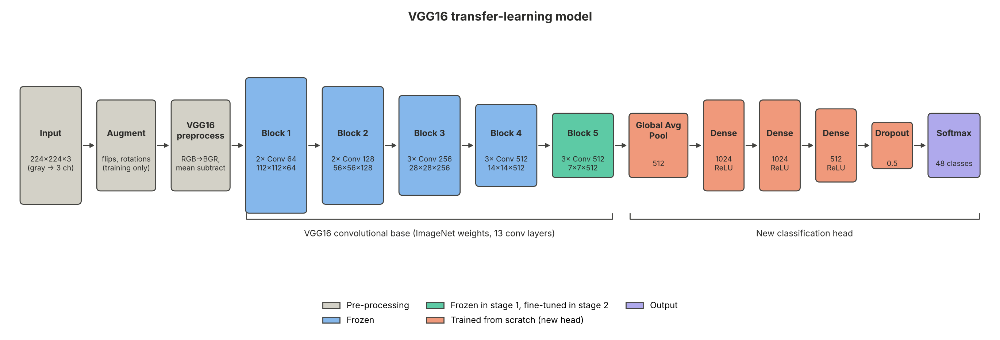

# Marine Organism Classification from Microscopic Images

Deep-learning classifier that identifies marine organisms (phytoplankton) from microscopic images.
The main model is **VGG16 transfer learning** (ImageNet weights, new fully connected head, 48-way softmax),
compared against a small **custom CNN baseline**. Everything is in one notebook:
[`marine_organism_classification.ipynb`](marine_organism_classification.ipynb).

## Highlights

- **Leak-free data pipeline:** raw images are preprocessed, split into train / validation / test (70/15/15, stratified) *first*, and only then are training images augmented. No augmented copy of an image can appear in validation or test, and the notebook asserts this.
- The test set is never used for training or tuning.
- Two-stage VGG16 training: train the new head on the frozen base, then fine-tune the last conv block.
- Reports **macro-F1, top-5 accuracy, per-class metrics and a confusion matrix**, not just accuracy, because plankton datasets are class-imbalanced.
- Exact-duplicate check to detect train/test leakage.

## Data pipeline

```
raw images ──► preprocess (grayscale, 224x224) ──► stratified split 70/15/15 ──► augment TRAIN only ──► train / evaluate
                                                         │
                                                         └─► val + test stay original (never augmented)
```

<!-- FILL IN: list the exact augmentation variants you used (e.g. darkened + rotated 90 deg). -->

## Dataset

<!-- FILL IN: dataset name, source link, licence/citation, number of classes (48) and images, how classes were selected. -->

The dataset is **not included**. Download the **original, un-augmented** images from the source above and arrange them with one folder per class:

```
data/raw/
├── Chaetoceros/   *.png
├── Corethron/     *.png
└── ...
```

## Model architecture



**VGG16 (main model)**
```
Input 224x224x3
  -> VGG16 convolutional base (5 blocks, ImageNet weights)
  -> GlobalAveragePooling -> Dense(1024) -> Dense(1024) -> Dense(512) -> Dropout(0.5)
  -> Dense(48, softmax)
```
**Custom CNN (baseline):** 3 x [Conv2D(32/64/128, 3x3) + MaxPool] -> Flatten -> Dense(256) -> Dropout(0.5) -> Dense(48, softmax).

## How to run

1. Open the notebook in [Google Colab](https://colab.research.google.com) and choose a **GPU runtime** (a CPU run takes hours per epoch).
2. Upload the raw dataset zip to Google Drive and set `RAW_ZIP` in the first cell.
3. Run the cells top to bottom. For a quick test, set `LIMIT_PER_CLASS = 20` and use 1 epoch.

Preprocessed images go to `data/processed/`, augmented training copies to `data/augmented_train/`, and results (model, metrics, curves, confusion matrix) to `runs/<model>/`.

## Results

Evaluated on the held-out **test** split.

| Model | Accuracy | Top-5 acc. | Macro-F1 |
|---|---|---|---|
| VGG16 (transfer learning) | TBD | TBD | TBD |
| Custom CNN (baseline) | TBD | TBD | TBD |

<!-- Replace TBD with the numbers from the notebook's final comparison table. -->

## Limitations and future work

- Class imbalance: try `use_class_weight=True` and compare macro-F1.
- Images are stretched to 224x224 without preserving aspect ratio; padding to a square first may help elongated chain-forming species.
- Try newer backbones (EfficientNet, ResNet50) and add Grad-CAM visualisations.

## License

MIT.
